# Shining Hotel

民宿線上訂房系統，包含**顧客端訂房網站**與**民宿後台管理系統**兩部分。顧客可以瀏覽房型與設施、線上訂房並自動計算金額，也能查詢、修改或刪除自己的訂單；管理者登入後台後，可以管理所有顧客資料、訂單與意見回饋。

- **前端**：HTML、CSS、JavaScript
- **後端**：Node.js、Express.js
- **資料庫**：Microsoft SQL Server(`mssql`套件)
- **部署**：IIS、Windows虛擬主機

> 網站原本部署在學校提供的虛擬主機上，目前主機已關閉、網址失效，因此改以下方的Demo影片與畫面截圖呈現。

## Demo影片

[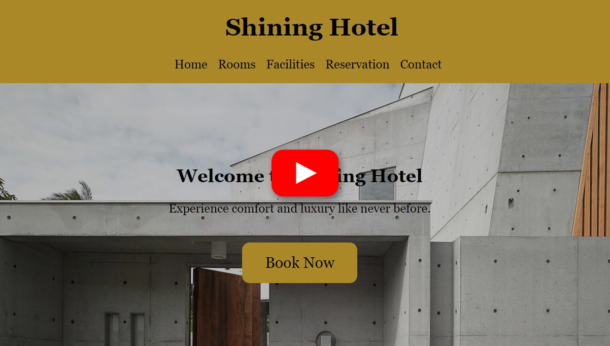](https://youtu.be/LFsqXCp3b1s)

點擊上方畫面即可觀看完整操作示範，也可以直接跳到各段落：

- [02:50](https://youtu.be/LFsqXCp3b1s?t=170)顧客端訂房網站Demo
- [06:09](https://youtu.be/LFsqXCp3b1s?t=369)管理員(老闆)後台網站Demo

## 功能

### 顧客端訂房網站

| 功能 | 說明 |
|---|---|
| 首頁 | 民宿介紹、景觀照片輪播，`Book Now`可直接前往訂房 |
| 房型介紹 | 5種房型的照片、坪數、床型與每晚價格 |
| 設施介紹 | Wi-Fi、泳池、閱讀室、餐廳等設施與照片輪播 |
| 線上訂房 | 填寫姓名、電話、Email、入住/退房日期、人數與房型，系統依房價與住宿天數自動計算總金額，再輸入轉帳資訊送出訂單 |
| 訂單查詢 | 以聯絡電話+Email查詢自己的所有訂單與付款狀態 |
| 修改/刪除訂單 | 可修改日期、房型與轉帳資訊；**入住前3天內**不開放修改，只能刪除 |
| 聯絡我們 | 填寫姓名、Email與訊息，送出意見回饋或問題 |

### 民宿後台管理系統

| 功能 | 說明 |
|---|---|
| 管理員登入/登出 | 帳號密碼比對資料庫中的管理員資料，登入失敗會顯示錯誤頁面 |
| 客戶資料管理 | 以ID、姓名、電話、Email搜尋顧客，可編輯或刪除(刪除時一併刪除該顧客的訂單) |
| 訂單管理 | 以ID、入住/退房日期、房號、付款狀態搜尋訂單，可修改日期、房號、金額與付款狀態，或刪除訂單 |
| 回饋管理 | 以姓名、Email搜尋顧客留言，可刪除單筆訊息 |

## 系統架構

```
瀏覽器(HTML/CSS/JS)
   │  表單送出 / fetch API
   ▼
Node.js + Express.js
   ├── booking-site    顧客端：訂房、查詢、修改、刪除、聯絡
   └── admin-dashboard 後台：登入驗證、顧客/訂單/回饋的CRUD API
   │  mssql
   ▼
Microsoft SQL Server(hotel資料庫)
```

部署時以IIS提供網頁，Node.js提供後端API，並連線到同一台主機上的SQL Server。

## 資料庫設計

共5個資料表：`Guests`(顧客)、`Reservations`(訂單)、`Rooms`(房型與房價)、`Contact`(意見回饋)、`Administrators`(管理員)。

| E-R Model | Schema Diagram |
|---|---|
| 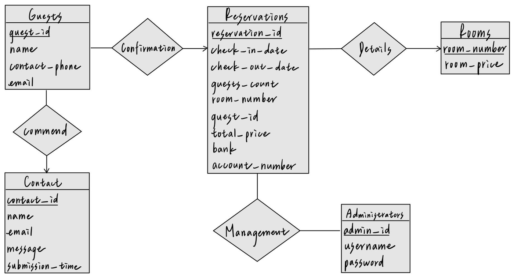 | 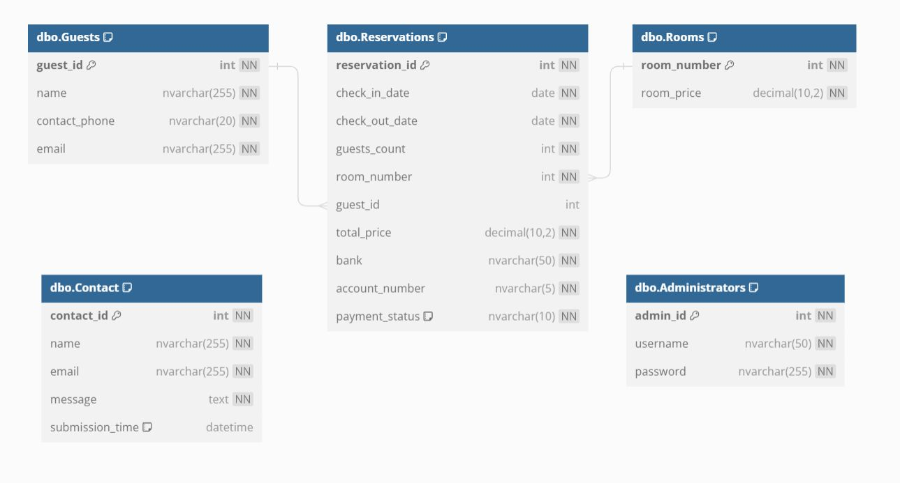 |

建立資料表的SQL請見[`database/schema.sql`](database/schema.sql)。

## 畫面截圖

### 顧客端

| 房型列表 | 房型介紹 |
|---|---|
| 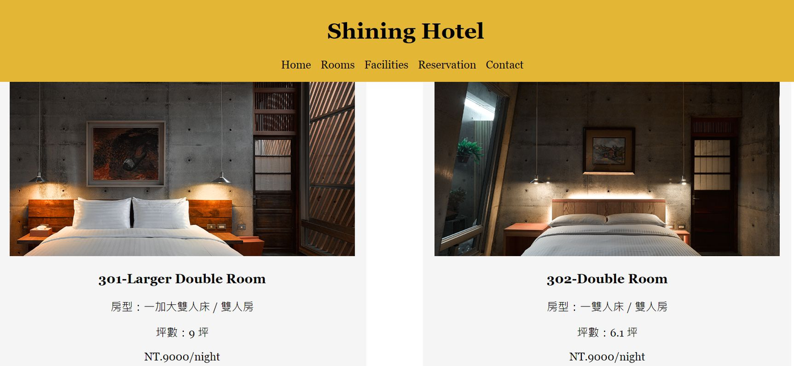 | 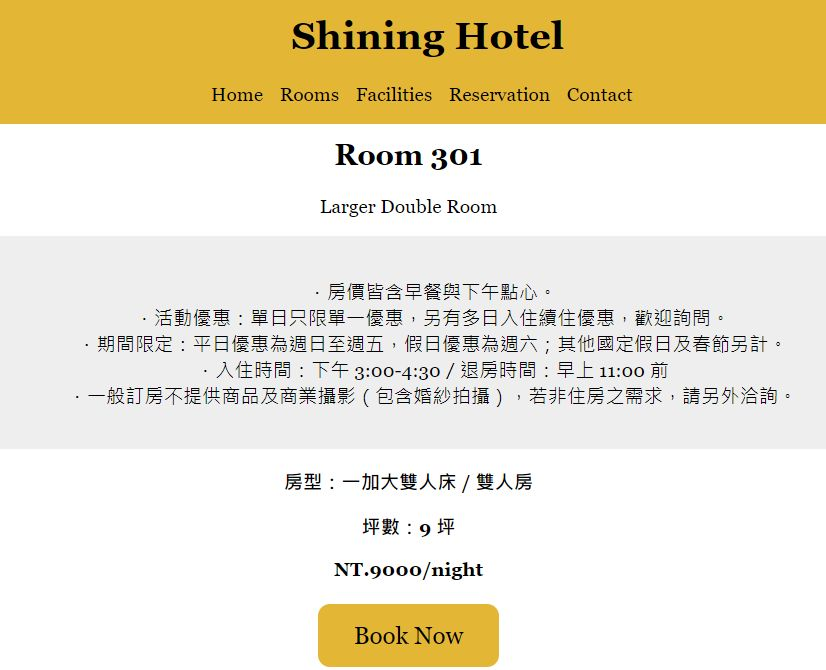 |

| 訂房表單 | 金額計算與轉帳資訊 |
|---|---|
| 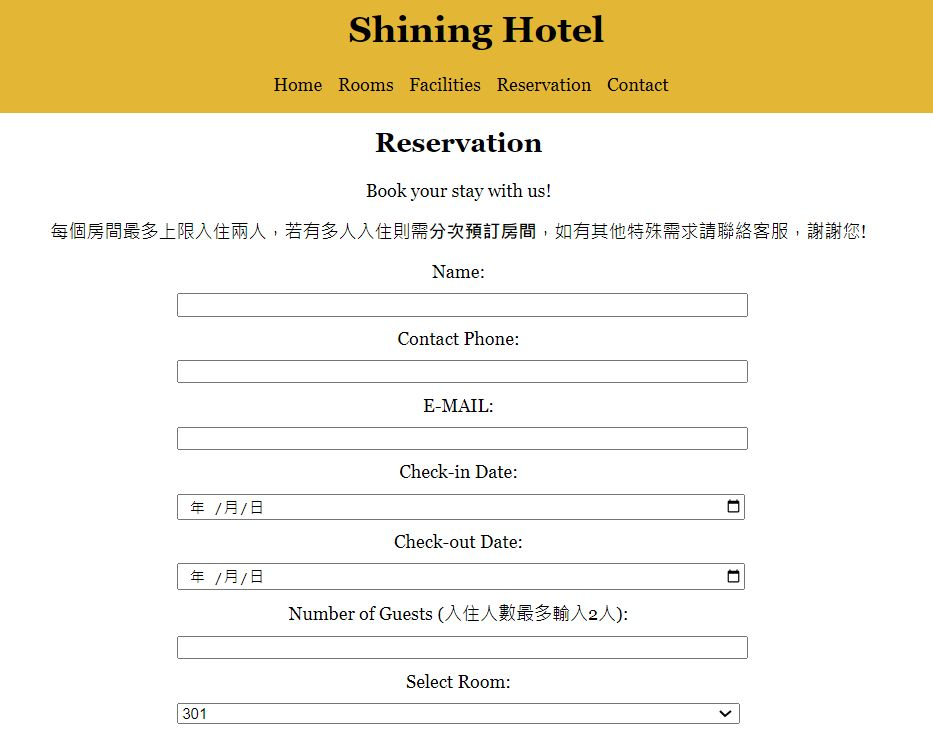 | 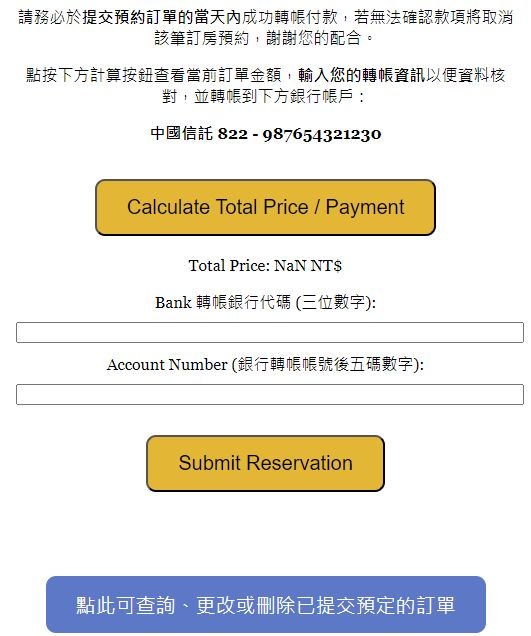 |

| 訂房成功與訂單查詢 | 修改訂單 |
|---|---|
| 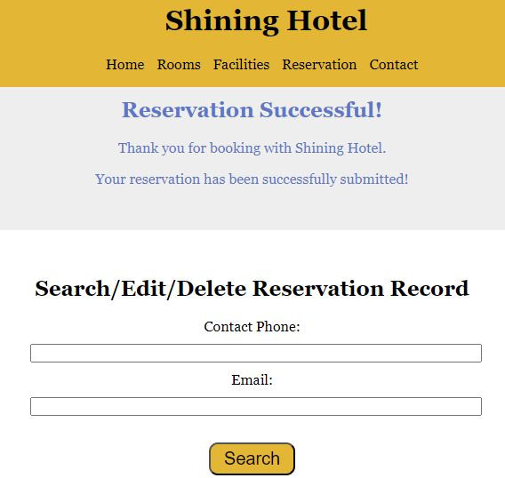 | 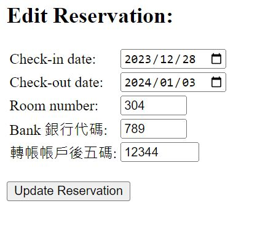 |

| 入住前3天內無法修改 | 聯絡我們 |
|---|---|
| 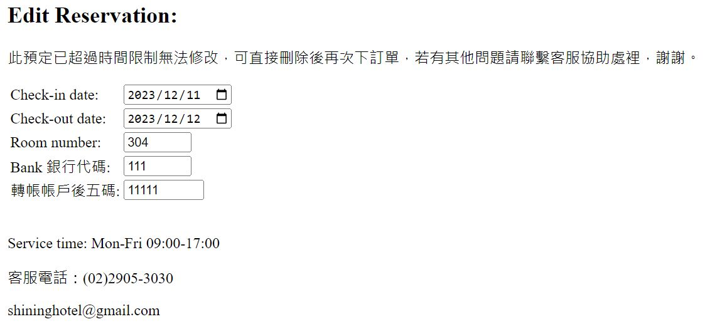 | 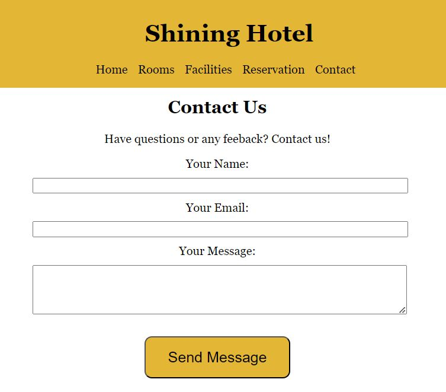 |

| 設施介紹 |
|---|
| 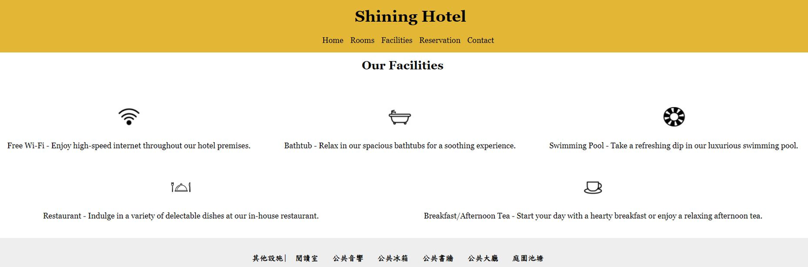 |

### 後台管理

| 管理員登入 | 客戶資料管理 |
|---|---|
| 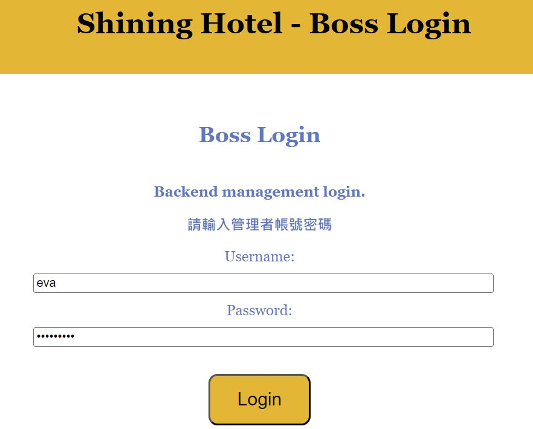 | 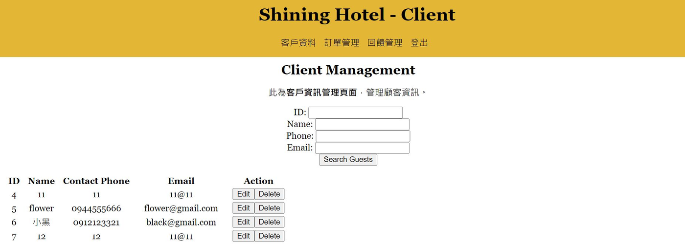 |

| 訂單管理 | 回饋管理 |
|---|---|
| 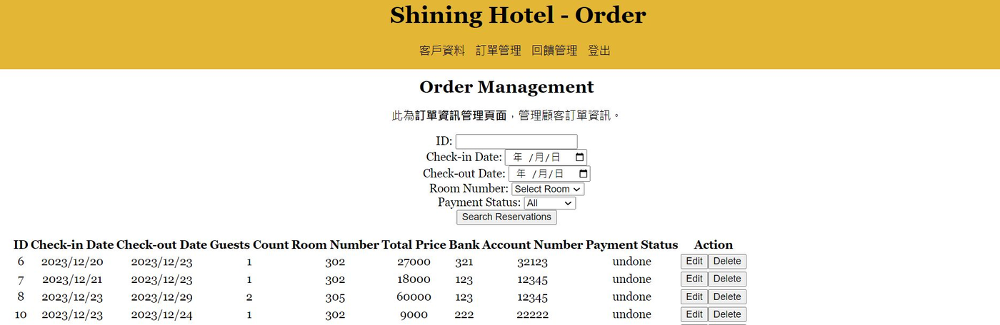 | 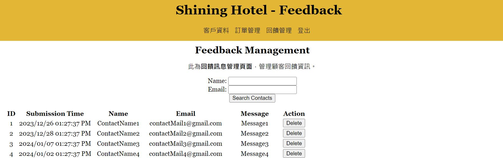 |

## 專案結構

```
Shining-Hotel/
├── booking-site/          顧客端訂房網站
│   ├── app.js             Express後端：訂房、查詢、修改、刪除、聯絡API
│   ├── index.html         首頁
│   ├── 2rooms.html        房型列表(room301~305.html為各房型介紹)
│   ├── 3facilities.html   設施介紹
│   ├── 4reservation.html  訂房表單
│   ├── 5contact.html      聯絡我們
│   ├── reservation-success.html  訂房成功與訂單查詢
│   └── styles.css
├── admin-dashboard/       民宿後台管理系統
│   ├── app.js             Express後端：登入驗證與顧客/訂單/回饋CRUD API
│   ├── index.html         管理員登入
│   ├── 1client.html       客戶資料管理
│   ├── 2order.html        訂單管理
│   └── 3feedback.html     回饋管理
├── database/schema.sql    資料表結構與初始資料
└── docs/                  E-R圖、Schema圖與畫面截圖
```

## 在本機執行

1. 安裝Node.js與Microsoft SQL Server，執行`database/schema.sql`建立資料庫。
2. 在`booking-site`與`admin-dashboard`中，各自將`.env.example`複製為`.env`，填入資料庫連線資訊。
3. 分別安裝套件並啟動：

   ```bash
   cd booking-site
   npm install
   npm start        # http://localhost:3000

   cd ../admin-dashboard
   npm install
   npm start        # http://localhost:5000
   ```

4. 網站圖片為網路素材，未收錄在此repo中；如需完整畫面，請自行在`booking-site/image/`放入對應檔名的圖片。

## 開發分工

本專案為4人團隊開發，我負責的部分：

- 顧客端訂房網站與後台管理系統的**整體前端介面**設計與開發
- **後端功能**的建置與修改：訂房、金額計算、訂單查詢/修改/刪除、聯絡表單、管理員登入，以及後台的搜尋與刪除功能(後台資料的線上編輯功能由組員完成)
- 以**IIS**將網站部署到虛擬主機
- 擔任主要報告者，負責系統Demo與功能說明

資料庫與後端的連線，以及部分功能的修改，由另一位組員協作完成。
